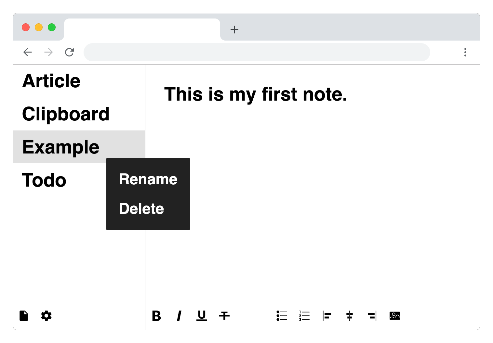

<p align="center"></p>
<h1 align="center">My Notes</h1>
<p align="center">
  
  
  
  <br><br>
  <br>
  <strong>My Notes</strong> — <a href="https://chromewebstore.google.com/detail/my-notes/lkeeogfaiembcblonahillacpaabmiop">Chrome extension</a> for simple and fast note-taking.<br>Zero setup, works offline, no account needed.
</p>

<br><br>

## Features

→ &nbsp; Zero setup — install and start writing

→ &nbsp; Works offline

→ &nbsp; Saved automatically and updated in every open tab ([How to open](#how-to-open))

→ &nbsp; Context menu to save selected text to a note, or to My Notes on other computers ([Context menu](#context-menu))

→ &nbsp; Back up notes to Google Drive ([Google Drive Sync](#google-drive-sync))

→ &nbsp; Sync notes with Google Drive and edit them from other devices ([Google Drive Sync](#google-drive-sync))

→ &nbsp; Auto Sync with Google Drive ([Google Drive Sync](#google-drive-sync))

→ &nbsp; Drag and drop images, uploaded automatically to Google Drive ([Google Drive Sync](#google-drive-sync))

→ &nbsp; Toolbar (**Bold**, _Italic_, <ins>Underline</ins>, etc.)

→ &nbsp; Themes (Light, Dark, Custom)

→ &nbsp; Keyboard shortcuts

→ &nbsp; [Command palette](#command-palette)

<br>

## How to open

**My Notes:**

<ol type="A">
  <li>Click the My Notes icon in the Chrome toolbar (pin it for quick access)</li>
  <li>Use a keyboard shortcut (see <code>chrome://extensions/shortcuts</code>)</li>
</ol>

**Options:**

<ol type="A">
  <li>Click the gear icon in the bottom left corner</li>
  <li>Right-click the pinned icon in the Chrome toolbar and select Options</li>
  <li>Click the three-dots icon next to My Notes in the Chrome toolbar and select Options</li>
  <li>Use a keyboard shortcut (see Options)</li>
</ol>

<br><br>

## Context menu

Right-click on any website to open the context menu and quickly save, depending on where you click:

<ol type="a">
  <li>selected text</li>
  <li>current page URL (right-click on an empty space)</li>
  <li>image</li>
</ol>

The destination can be any local note, or My Notes on other computers.

The options depend on the context, but in general are:

- `Save to [note name]` — one option for every note. My Notes doesn't have to be open, and Google Drive Sync is not required.
- `Save to remotely open My Notes` — My Notes must be open on the other computers, and Chrome must be signed in to the same Google Account on each of them. Google Drive Sync is not required. The destination note is named `@received`.

A few general-purpose notes can be used as destinations. Their names start with `@`, and they are created automatically when needed:

- `@received`
- `@clipboard`
- `@images`

<br><br>

## Custom theme

The Custom theme lets you customize the look of My Notes in many ways.

To use it, open Options, select the **"Custom"** theme, and click the **"Customize"** button.

To start, either paste the content of [light.css](public/themes/light.css) or [dark.css](public/themes/dark.css) into the editor, or use CSS `@import` to base your theme on one of them.

Then change the CSS variables to set background colors, text colors, etc.
You can also add any valid CSS for further changes.

Click the **"Save"** button to save the Custom theme.

<br><br>

## Command palette

The Command palette opens with `Cmd + P` (or `Ctrl + P`) and lets you quickly find and run commands with the keyboard.

Use the `Up` and `Down` arrow keys to move between commands, and `Enter` to run the selected one.

Repeat the last command with `Cmd + Shift + P` (or `Ctrl + Shift + P`).

<br><br>

## Google Drive Sync

Google Drive Sync (see Options) saves your notes to your personal Google Drive and syncs the changes between My Notes and Google Drive every time you click the "Sync now" button (bottom left corner).

**Why sync:**

- A backup of your notes (notes can be restored)
- Edit notes in Google Drive or other apps, and see the changes in My Notes
- Sync and edit notes on other computers (install My Notes and use the same Google Account)

### Location

Notes are uploaded to the "My Notes" folder in your Google Drive. The folder is created automatically.
If the folder exists from a previous installation, My Notes keeps using it: the notes in the folder are downloaded, and your local notes are uploaded to it.

### Synchronization

Synchronization works both ways — to and from Google Drive.

Notes are synchronized every time you click the "Sync now" button.
The button spins while synchronization is in progress.
Its tooltip shows the time of the last synchronization.

### Auto Sync

Auto Sync (see Options) syncs your notes to and from Google Drive every time you open My Notes, and every 6 seconds if your local notes changed since the last sync.

### Image upload

When Google Drive Sync is enabled and you are online, you can drag and drop one image at a time into a note. Each image is uploaded right away to the "My Notes" / "assets" folder in your Google Drive. The folder is created automatically.

### Access

My Notes can only access the "My Notes" folder it created, and the files it created inside it.
It cannot see, access, or modify any other files in your Google Drive.

<br><br>

## Tips and tricks

1. Set a keyboard shortcut to open My Notes quickly (e.g. `Cmd + Shift + M`) at `chrome://extensions/shortcuts`. If you make the shortcut Global, it opens My Notes even when Google Chrome is closed.
2. See the keyboard shortcuts in Options for quick actions.
3. Use `Cmd + Shift + V` (or `Ctrl + Shift + V`) to paste plain text (without formatting).
4. Hide the Toolbar and Sidebar for a simpler interface. Use keyboard shortcuts or the [Command palette](#command-palette) to do it.
5. Pick a font on [Google Fonts](https://fonts.google.com) and write its name in My Notes Options to use it.
6. The note name is in the URL, so you can bookmark a note for quick access. Append `&focus` to the bookmarked URL to always open the note in Focus mode (Sidebar and Toolbar hidden).
7. Use the [Context menu](#context-menu) to send selected text to My Notes on other computers.
8. Use a [Custom theme](#custom-theme) to customize the look of My Notes in any way.
9. Drag and drop selected text onto a note's name in the Sidebar to insert the text into the note.
10. Drag and drop a TXT or HTML file onto the icon area at the bottom of the Sidebar to import it as a new note.
11. Drag the Sidebar line to resize the Sidebar. Double-click the line to restore the original width.
12. Hold `Cmd` (or `Ctrl`) and scroll up or down over an image to resize it. Double-click the image to restore its original size.
13. Hold `Cmd` (or `Ctrl`) and right-click anywhere in a table to open a context menu for aligning the table (Left, Center, Right).

<br><br>

## How to contribute

1. Share your feedback (what to improve, what to change) in [Issues](https://github.com/penge/my-notes/issues) or join [Discussions](https://github.com/penge/my-notes/discussions).
2. Join the development.
3. Help test upcoming versions.
4. Help improve the documentation.
5. [Buy Me a Coffee](https://www.buymeacoffee.com/penge).

<br><br>

## How to develop

Develop:

```
$ npm install
$ export MY_NOTES_CLIENT_ID=<CLIENT_ID>    # needed when developing Google Drive Sync
$ npm run develop-watch                    # see "dist" folder
```

`MY_NOTES_CLIENT_ID` can be created at [Google Cloud](https://console.cloud.google.com) / APIs & Services / Credentials / OAuth 2.0 Client IDs.

Code check:

```
$ npm run lint
```

Tests:

```
$ npm test
```

Build:

```
$ npm run build     # see "dist" folder
$ npm run package   # installs from the lockfile, builds and zips "dist" into my-notes-<version>.zip, for the Chrome Web Store
```

<br><br>

## Folder structure

```
env/              # Environment helpers

dist/             # Bundled My Notes (excluded from Git)

scripts/          # Release scripts (set-version)

src/
  background/
    google-drive/   # Everything related to Google Drive Sync
                      # - File operations (List, Create, Get, Update, Delete)
                      # - Synchronization (to Google Drive, from Google Drive)
                      # - Queries (find My Notes folder, list files in My Notes folder)
                      # - Multipart bodies (create My Notes folder, create file, update file)
                      # - Tests

    init/           # Runs when My Notes is installed/updated
                      # - Sets a unique ID for the My Notes installation (used by Context menu), if not already set
                      # - Migrates notes and options
                      # - Creates Context menu and attaches the events
                      # - Creates a notification when My Notes is installed/updated
                      # - Registers the ways to open My Notes (icon click, keyboard shortcut)
                      # - Registers events to trigger Google Drive Sync from My Notes

  i18n/             # Internationalization (English)

  integration/      # Integration tests for Google Drive Sync

  notes/            # Everything related to Notes
                      # - Note editing, Note saving
                      # - Sidebar
                      # - Toolbar

  options/          # Everything related to Options
                      # - Font
                      # - Theme (Light, Dark, Custom)
                      # - Shortcuts
                      # - Google Drive Sync
                      # - Export & Import

  shared/           # Everything common (used in several places)
                      # - Date formatting (Last sync)
                      # - Managing the permissions (Requesting, Removing, Checking)
                      # - Helpers for Chrome Storage
                      # - Default values (Notes, Options)

  svg/              # SVG images for Toolbar

  themes/           # Light, Dark, Custom

  background.ts     # Main script for service worker
  notes.tsx         # Main script for notes
  options.tsx       # Main script for options
  template.html     # Template for notes.html and options.html

public/             # All public files (images, icons, HTML, CSS) copied to dist/

.editorconfig     # To enforce same editor configuration
.eslintrc         # To enforce code quality and same coding style with ESLint
.eslintignore     # Files excluded from ESLint checking
.gitignore        # Files excluded from Git
.nvmrc            # Node version

jest.config.ts    # Jest configuration
jest.setup.ts     # Jest setup
tsconfig.json     # TypeScript configuration

package-lock.json
package.json

LICENSE           # MIT
manifest.json     # Main extension file

build.ts          # Produces dist/ folder
watch.ts          # Rebuilds dist/ on changes (npm run develop-watch)

README.md
```

<br><br>

## Browser support

My Notes fully supports Google Chrome only. It may be possible to install it in other browsers, but the support is not complete.

Support for other Chromium-based browsers will be added if possible.

<br><br>

## Security and Privacy

My Notes doesn't collect any personal information or data.
All your notes are stored locally in your browser.
If you use Google Drive Sync, My Notes can back up the notes to your personal Google Drive.

To provide Google Drive functionality, My Notes has an application in Google Cloud.
The application's sole purpose is to authenticate you securely with Google Drive and to allow the synchronization of notes.

<br><br>

## Permissions

My Notes has the permissions listed in `manifest.json`.

**Required:**

- `"storage"` — used to save your notes and options to Chrome Storage (locally in your Chrome)
- `"unlimitedStorage"` — used to increase the default storage limit (which is 5MB)
- `"contextMenus"` — used to create the My Notes Context menu
- `"notifications"` — used to show a Chrome notification (when Context menu was used)

Required permissions are shown before installing the extension, and are needed at all times to provide the basic functionality.

**Optional:**

- `"identity"` — needed for "Enable Google Drive Sync" (see Options)

Optional permissions are needed only for additional functionality, enabled with a checkbox in Options.

You can either approve or deny the optional permissions.

<br><br>

## FAQ

**1. Where is My Notes published? What is the process behind publishing My Notes?**

My Notes is published on the [Chrome Web Store], the store for Google Chrome extensions.
When publishing a new version, I first make a [new release](https://github.com/penge/my-notes/releases) here on GitHub.
Then I build the new release and upload it to the Chrome Web Store for review.
The review usually takes between 24 hours and a few days.
After a successful review, the new version is available on the Chrome Web Store.

<br>

**2. Can I install My Notes manually by downloading it from GitHub?**

Yes, but keep in mind that Google Drive Sync works only if My Notes is installed from the [Chrome Web Store].
To install My Notes manually, download the zip file of the [latest release](https://github.com/penge/my-notes/releases), unpack it, and run `npm install` and `npm run build`.
Then open `chrome://extensions` in Google Chrome, click the **"Load unpacked"** button, and select the `dist` folder.

<br>

**3. Why isn't Google Drive Sync working?**

Google Drive Sync works only if My Notes is installed from the Chrome Web Store on Google Chrome.
There are two reasons for this.
First, Google Chrome provides the `identity` API that My Notes relies on.
Second, for security reasons, Google Drive Sync works only if My Notes has the ID **"lkeeogfaiembcblonahillacpaabmiop"**, which is its ID on the Chrome Web Store (also in the URL).
When My Notes is installed manually, it gets a different ID.

<br>

**4. What browsers and operating systems are supported?**

Currently, only Google Chrome is supported.
Other Chromium-based browsers may follow, if possible.
Windows, macOS, Linux, and Chromebooks are supported.

<br>

**5. How can I open or edit notes from my phone?**

If Google Drive Sync is enabled, My Notes syncs your notes to and from the **"My Notes"** folder in your personal Google Drive.

To access your Google Drive from a phone, install the Google Drive app.
To open a note, tap it in the folder.
To edit a note, tap the overflow menu (the three-dot icon) next to it, select "Open with", and choose an editor from the list.

<br>

**6. What is the size limit for my notes?**

Notes are _NOT_ limited in size, thanks to the `"unlimitedStorage"` permission.

<br>

**7. (Google Drive) Where are images uploaded?**

Images are uploaded to the "My Notes" / "assets" folder in your personal Google Drive. The **"assets"** folder is created automatically when needed.

<br>

**8. (Google Drive) Are images stored privately?**

Yes, only you can see the images. To share an image publicly or with someone specific, use the **Share** button in Google Drive.

<br>

**9. (Google Drive) Are images deleted from my Google Drive after I remove them from a note?**

No, images stay in your Google Drive for future use, so they don't have to be uploaded again.
To delete an image permanently, delete it in Google Drive.

<br>

**10. (Google Drive) How can I reuse a previously uploaded image after I have removed it from a note?**

Go to your Google Drive, right-click the image you'd like to insert, and select "Get link".
Copy the link and paste it into My Notes using the "Insert Image" button.

<br>

**11. Is My Notes free?**

Yes. My Notes is open source and free to download, install, and use.
The recommended way to install My Notes is from the [Chrome Web Store].

<br><br>

---

<p align="center"><code>Created with ❤ in 2019.</code></p>

[Chrome Web Store]: https://chromewebstore.google.com/detail/my-notes/lkeeogfaiembcblonahillacpaabmiop
